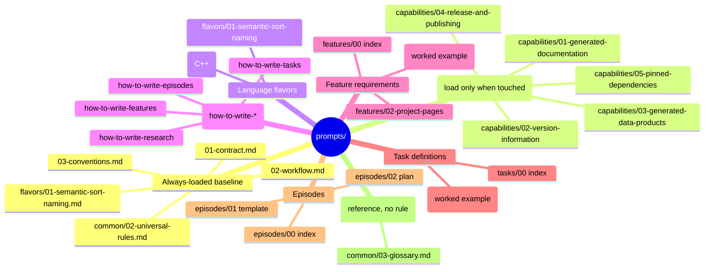

# Prompt Corpus Mind-Map

A visual map of the `prompts/` corpus, grouped by role and load condition.

The always-loaded baseline applies to every task.
The capability, language-flavor, and authoring-guide files load only when a task touches them.
The feature, task, and episode files are dispatched work, not standing rules.

