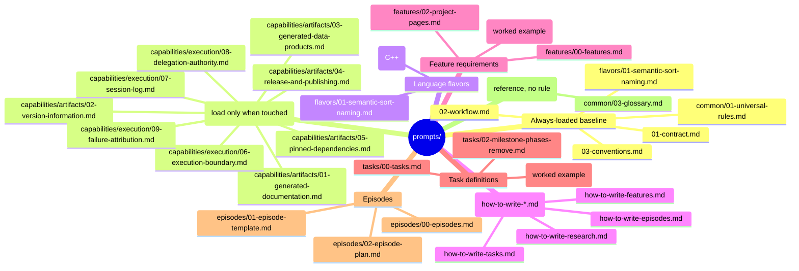

# Prompt Corpus Mind-Map

A visual map of the prompt files drawn below, grouped by role and load condition.

As of 2026-11-27, the map omits `prompts/10-project.md` and the four files under `prompts/prose/`.

The always-loaded baseline applies to every task.
It lists `flavors/01-semantic-sort-naming.md`, which also appears under Language flavors, so that file loads on every task.
Capability files load only when a task touches them.
The remaining language-flavor files load only when a task touches them.
An authoring guide loads when its artifact is written or validated.
The feature, task, and episode files are dispatched work, not standing rules.
The glossary is a reference and defines no rule.

Load a non-baseline branch only when the task touches it.

