# Prompt Relations Graph

A knowledge graph of how the prompt files relate: authority, load order, references, feature traceability, and the mechanical checks that enforce them.

How to read it: start at the contract (`C1`).
The legend defines each edge style and label.

Legend:

- A solid arrow is a structural edge: one file references, dispatches, or depends on another.
- A dotted arrow is a relation from one node to another.
  An unlabeled dotted arrow is an authority pointer to the rule's single home.
  A labeled dotted arrow names its relation, for example an authority pointer, a load-order pointer, a worked-example pointer, an acceptance trace, or an enforcement check.
- The `§` in an edge label names a section of a file that states the relation.
- The short ids `C1` and `W2` name the contract (`01-contract.md`) and the workflow (`02-workflow.md`).
- The `ENF` subgraph holds the checks.

Scope: the files drawn below.
As of 2026-11-27, the graph omits `prompts/10-project.md` and the four files under `prompts/prose/`.

```mermaid
flowchart TD
  subgraph DESC["Descriptive - context, defines no rule"]
    README["README.md"]
    AGENTS["AGENTS.md<br/>(tool-neutral entry point)"]
    DOCS["documents/*.md<br/>(rationale + field lessons)"]
    GLOSS["common/03-glossary.md"]
  end

  subgraph CONV["Conventions"]
    C3["03-conventions.md"]
    F1["flavors/01-semantic-sort-naming.md"]
    F2["flavors/02-cpp-conventions.md (C++)"]
    CAP_A["capabilities/artifacts/01..05.md"]
    CAP_E["capabilities/execution/06..09.md"]
    HT["how-to-write-*.md"]
    EP["episodes/01-episode-template.md, 02-episode-plan.md"]
    REC["records/README.md"]
    TR["tests/README.md"]
    TOOLS["tools/*.md (per-tool)"]
  end

  subgraph GLOBAL["Global requirements"]
    UNIV["common/01-universal-rules.md"]
  end

  subgraph FEAT["Feature requirements"]
    FEAT1["features/01-site-build.md<br/>(worked example)"]
    FEAT2["features/02-project-pages.md"]
  end

  subgraph WF["Workflow"]
    W2["02-workflow.md"]
  end

  subgraph CT["Contract"]
    C1["01-contract.md<br/>§2 = the authority registry"]
  end

  subgraph DISP["Dispatched work - precedence 3"]
    TASK["tasks/01-site-build-implement.md"]
    EPI["episodes/*"]
  end

  subgraph ENF["Mechanical enforcers"]
    V["tests/09-prompt-contract.sh"]
    CORPUS["tests/10-prompt-validator.sh"]
    BUDGET["scripts/context-budget.sh"]
  end

  AGENTS --> C1
  AGENTS --> W2
  AGENTS --> C3
  AGENTS --> HT

  C1 -. "§2 registry" .-> W2
  C1 -.-> C3
  C1 -.-> UNIV
  C1 -.-> F1
  C1 -.-> CAP_A
  C1 -.-> CAP_E
  C1 -.-> HT
  C1 -.-> REC
  C1 -.-> TR
  C1 -.-> FEAT1
  C1 -.-> FEAT2

  W2 -. "§1 baseline load order" .-> C1
  W2 -.-> C3
  W2 -.-> UNIV
  W2 -.-> F1
  W2 -. "§3.1 worked example" .-> DOCS

  C3 -. "§4 naming" .-> F1
  C3 -. "§8 output/scope" .-> C1
  C3 -.-> UNIV
  UNIV -. "output §5 / DELTA §6 / untrusted §8" .-> C1
  UNIV -. "filename §3.1" .-> C3
  GLOSS -. "each term -> its authoritative file" .-> C1
  HT -. "apply naming" .-> F1
  HT -. "authorization -> contract §3" .-> C1

  FEAT2 -- "Dependencies" --> FEAT1
  TASK -- "TASK-FEATURES" --> FEAT1
  TASK -. "TASK-ACCEPTANCE -> SITE-BUILD-R001/002/011" .-> FEAT1
  EPI -. "template + authoring rules" .-> HT

  V -. "resolves every prompt/... ref, one-home-per-rule" .-> C1
  V --> CORPUS
  BUDGET -. "enforces §1 baseline + budget" .-> W2
```

