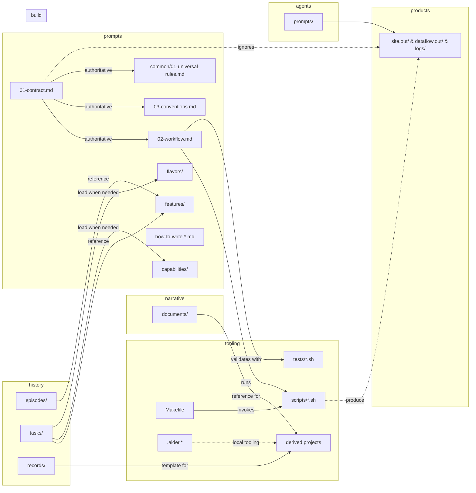

# Skeleton Knowledge Graph

A map of the skeleton's directories, the files that relate them, and the products they generate.
It is a reference for a project owner who is deciding where a file belongs.

How to read it: start at `01-contract.md`, which names the authoritative file for each rule.
The other edges show the workflow, the prompt corpus, the history, and the products.

Legend:

- A solid arrow is a structural relation: one file invokes, references, or produces another.
- A dotted arrow is an informational relation: one file explains or ignores another.
- A subgraph groups files by role.

